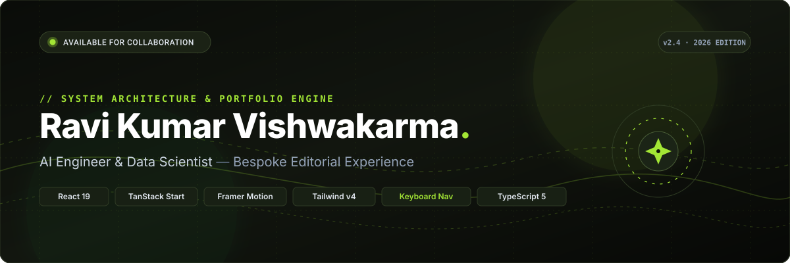
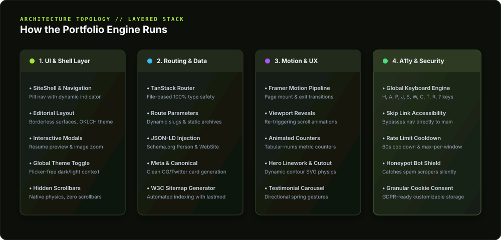
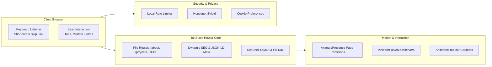
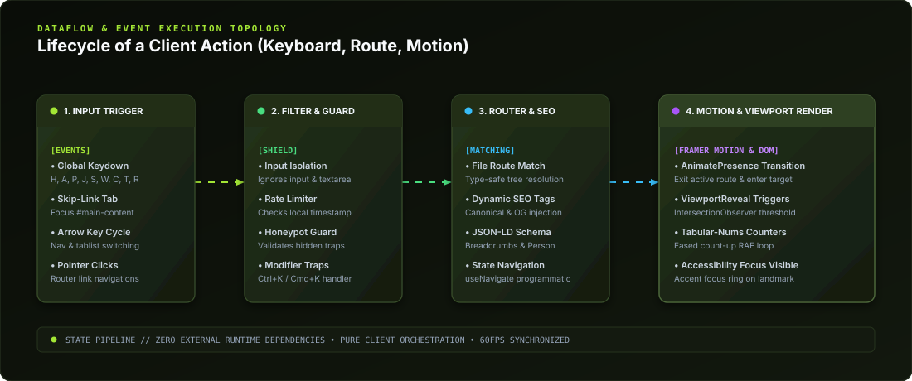
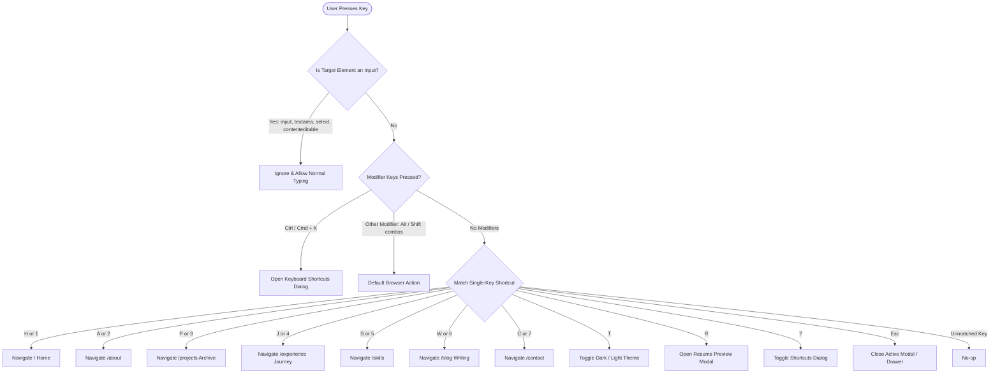
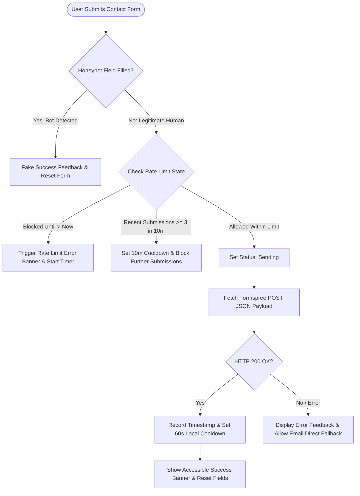

<div align="center">

<p align="center">
  
</p>

# ✦ Intelligent Systems & Editorial Web Engineering ✦

<p align="center">
  <strong>A modern, motion-first personal portfolio web application built with React 19, TanStack Start &amp; Router, Framer Motion, and Tailwind CSS.</strong>
</p>

<p align="center">
  <a href="https://profileravi.vercel.app">
    
  </a>
  <a href="https://github.com/ravikumar3481/profileravi">
    
  </a>
  <a href="#-license">
    
  </a>
</p>

<p align="center">
  
  
  
  
  
  
  
  
</p>

<br />

<!-- Animated Motion Graphic SVG Showcase -->
<p align="center">
  
</p>

</div>

---

## ✦ System Architecture & Topologies

<div align="center">
  
</div>

<br />

The application is engineered as a high-performance Single Page Application leveraging **TanStack Router / TanStack Start** for file-based type-safe routing, client-side caching, and dynamic metadata injection.



---

## ✦ Execution Flowcharts

### 1. Client Action & Viewport Lifecycle Flowchart

<div align="center">
  
</div>

<br />

### 2. Keyboard Navigation Event Loop Flowchart



<br />

### 3. Contact Form Security & Anti-Spam Pipeline Flowchart



---

## ✦ Core Feature Highlights

<table width="100%">
  <tr>
    <td width="50%" valign="top">
      <h3>⚡ Motion-First Interaction Engine</h3>
      <ul>
        <li><b>Dynamic Viewport Reveals:</b> Re-triggering scroll reveal animations using Framer Motion with custom thresholds.</li>
        <li><b>Tabular Animated Counters:</b> Numeric count-up animations for key statistics using requestAnimationFrame and cubic bezier easing.</li>
        <li><b>Seamless Route Transitions:</b> Coordinated page entrance and exit transitions with zero layout shift.</li>
        <li><b>Ambient SVG Physics:</b> Generative topographic contours and linework with pulse frequencies.</li>
      </ul>
    </td>
    <td width="50%" valign="top">
      <h3>⌨️ Deep Keyboard Accessibility</h3>
      <ul>
        <li><b>Global Shortcuts:</b> Single-key jumps (<kbd>H</kbd>, <kbd>A</kbd>, <kbd>P</kbd>, <kbd>J</kbd>, <kbd>S</kbd>, <kbd>W</kbd>, <kbd>C</kbd>) plus theme (<kbd>T</kbd>) and resume (<kbd>R</kbd>).</li>
        <li><b>Accessible Skip Link:</b> Instantly focusable on initial <kbd>Tab</kbd> press to bypass navigation header.</li>
        <li><b>Arrow-Key Navigation:</b> Cycle navigation pills, project category filter tabs, and image sliders.</li>
        <li><b>Smart Input Shielding:</b> Automatically silences shortcuts when typing in form fields or editable areas.</li>
      </ul>
    </td>
  </tr>
  <tr>
    <td width="50%" valign="top">
      <h3>🎨 Bespoke Editorial Design System</h3>
      <ul>
        <li><b>OKLCH Color Palette:</b> Tailored high-gamut color spaces with adaptive dark and light mode tokens.</li>
        <li><b>Borderless Modern Surfaces:</b> Elevation and depth conveyed via glassmorphism and soft ambient borders.</li>
        <li><b>Hidden Global Scrollbars:</b> Native scroll physics preserved while hiding distracting default scrollbars.</li>
        <li><b>Fluid Typography:</b> Scaled typography with custom Google serif and sans-serif pairings.</li>
      </ul>
    </td>
    <td width="50%" valign="top">
      <h3>🛡️ Privacy, Security &amp; Anti-Spam</h3>
      <ul>
        <li><b>Client-Side Rate Limiter:</b> Local cooldown enforcement with countdown timers preventing automated spam.</li>
        <li><b>Invisible Honeypot:</b> Bot detection trap field filtering spam bots silently.</li>
        <li><b>Granular Cookie Banner:</b> GDPR-compliant consent manager with customizable preference categories.</li>
        <li><b>SEO &amp; JSON-LD:</b> Search engine indexing with semantic schemas for Person and WebSite.</li>
      </ul>
    </td>
  </tr>
</table>

---

## ✦ Reusable SVG & Badge Components Library

The application features a dedicated, modular React SVG component suite located in `src/components/svg/`:

<table width="100%">
  <tr>
    <td width="33%" valign="top">
      <h4>🛠️ Tech Stack SVG Icons</h4>
      <code>src/components/svg/tech-icons.jsx</code>
      <ul>
        <li><code>&lt;ReactIcon /&gt;</code></li>
        <li><code>&lt;TypeScriptIcon /&gt;</code></li>
        <li><code>&lt;PythonIcon /&gt;</code></li>
        <li><code>&lt;PyTorchIcon /&gt;</code></li>
        <li><code>&lt;TanStackIcon /&gt;</code></li>
        <li><code>&lt;TailwindIcon /&gt;</code></li>
        <li><code>&lt;ViteIcon /&gt;</code></li>
        <li><code>&lt;DockerIcon /&gt;</code></li>
        <li><code>&lt;FastApiIcon /&gt;</code></li>
        <li><code>&lt;PostgreSQLIcon /&gt;</code></li>
      </ul>
    </td>
    <td width="33%" valign="top">
      <h4>🏷️ Visual Badges</h4>
      <code>src/components/svg/visual-badges.jsx</code>
      <ul>
        <li><code>&lt;LivePulseBadge /&gt;</code><br/>Animated live pulse status indicator</li>
        <li><code>&lt;VerifiedBadge /&gt;</code><br/>Verification checkmark emblem</li>
        <li><code>&lt;EditorialPillBadge /&gt;</code><br/>Icon pill badge with counters</li>
        <li><code>&lt;CodeMetricBadge /&gt;</code><br/>Monospace numeric stat card</li>
        <li><code>&lt;KeyboardKeyBadge /&gt;</code><br/>Accessible styled key badge</li>
      </ul>
    </td>
    <td width="34%" valign="top">
      <h4>🌊 Ambient Visuals</h4>
      <code>src/components/svg/ambient-visuals.jsx</code>
      <ul>
        <li><code>&lt;ContourGraphic /&gt;</code><br/>Topographic vector contours</li>
        <li><code>&lt;SignalWaveform /&gt;</code><br/>Harmonic waveform bars</li>
        <li><code>&lt;GeometricMatrix /&gt;</code><br/>Developer grid dot matrix</li>
        <li><code>&lt;AbstractSparkle /&gt;</code><br/>Geometric 4-point accent star</li>
      </ul>
    </td>
  </tr>
</table>

```javascript
// Clean barrel import example
import { ReactIcon, LivePulseBadge, ContourGraphic } from "@/components/svg";
```

---

## ✦ Complete Keyboard Shortcuts Matrix

| Key / Combination                              | Scope                 | Description                                                    |
| ---------------------------------------------- | --------------------- | -------------------------------------------------------------- |
| <kbd>H</kbd> / <kbd>1</kbd>                    | Global                | Navigate to Home (`/`)                                         |
| <kbd>A</kbd> / <kbd>2</kbd>                    | Global                | Navigate to About (`/about`)                                   |
| <kbd>P</kbd> / <kbd>3</kbd>                    | Global                | Navigate to Projects Archive (`/projects`)                     |
| <kbd>J</kbd> / <kbd>4</kbd>                    | Global                | Navigate to Journey &amp; Education (`/experience`)            |
| <kbd>S</kbd> / <kbd>5</kbd>                    | Global                | Navigate to Skills &amp; Toolbox (`/skills`)                   |
| <kbd>W</kbd> / <kbd>6</kbd>                    | Global                | Navigate to Writing &amp; Blog (`/blog`)                       |
| <kbd>C</kbd> / <kbd>7</kbd>                    | Global                | Navigate to Contact (`/contact`)                               |
| <kbd>T</kbd>                                   | Global                | Toggle Dark / Light Theme                                      |
| <kbd>R</kbd>                                   | Global                | Open Interactive Resume Modal                                  |
| <kbd>?</kbd> or <kbd>Ctrl</kbd> + <kbd>K</kbd> | Global                | Open Keyboard Navigation Guide dialog                          |
| <kbd>←</kbd> / <kbd>→</kbd>                    | Navigation &amp; Tabs | Cycle header navigation links, filter tabs, or gallery slides  |
| <kbd>Z</kbd>                                   | Image Viewer          | Toggle high-resolution zoom                                    |
| <kbd>Home</kbd> / <kbd>End</kbd>               | Image Viewer          | Jump to the first or last gallery screenshot                   |
| <kbd>Esc</kbd>                                 | Modals                | Close active dialog, image viewer, or mobile navigation drawer |
| <kbd>Tab</kbd>                                 | Accessibility         | Move focus to next element (Triggers Skip Link on first press) |

---

## ✦ Project Directory Layout

```text
├── public/                 # Static assets, sitemap.xml, robots.txt
│   └── readme/             # Visual banners, flowcharts & motion graphics
│       ├── banner.svg      # Hero branding SVG
│       ├── motion-graphic.svg # Animated keyframe motion graphic
│       ├── architecture.svg# Layered stack diagram
│       └── runtime-flowchart.svg # Client execution flowchart
├── src/
│   ├── components/
│   │   ├── animated-counter.jsx    # Viewport-triggered numeric counter
│   │   ├── cookie-consent.jsx      # Privacy cookie banner & preferences
│   │   ├── extras.jsx              # Sliders, GitHub widgets, modals, timelines
│   │   ├── keyboard-shortcuts.jsx  # Keyboard hook & shortcuts dialog
│   │   ├── portrait-hero.jsx       # Hero linework & visual presentation
│   │   ├── portfolio.jsx           # Core page sections, shells & layouts
│   │   ├── svg/                    # Reusable React SVG components & badges
│   │   │   ├── tech-icons.jsx      # Tech stack logos & icons
│   │   │   ├── visual-badges.jsx   # Live pulse, verified, key badges
│   │   │   ├── ambient-visuals.jsx # Contours, waveforms, geometric grids
│   │   │   └── index.js            # Unified barrel export
│   │   ├── ui/                     # Radix-based UI primitives (dialog, button, etc.)
│   │   └── viewport-reveal.jsx     # Framer motion scroll reveal wrapper
│   ├── data/
│   │   ├── portfolio.js            # Profile configuration, SEO helpers
│   │   └── *.json                  # Experience, education, skills, articles
│   ├── routes/                     # TanStack Router file-based route definitions
│   │   ├── __root.tsx              # Root layout, meta, canonical & JSON-LD
│   │   ├── index.tsx               # Home route
│   │   ├── about.tsx               # About route
│   │   ├── projects.index.tsx      # Projects archive route
│   │   ├── projects.$slug.tsx      # Project detail dynamic route
│   │   ├── experience.tsx          # Experience & education route
│   │   ├── skills.tsx              # Skills & tools route
│   │   ├── blog.tsx                # Writing & articles route
│   │   ├── contact.tsx             # Contact route
│   │   └── ...                     # Additional routes & legal views
│   ├── test/                       # Vitest route & component tests
│   ├── main.tsx                    # Application entry point
│   └── styles.css                  # Core design tokens, global themes & layout rules
├── package.json                    # Dependencies and npm scripts
├── tsconfig.json                   # TypeScript configuration
└── vite.config.ts                  # Vite build configuration & plugins
```

---

## ✦ Getting Started Locally

### Prerequisites

- **Node.js**: `v18.0.0` or higher
- **Package Manager**: `npm`, `pnpm`, or `yarn`

### Setup Instructions

1. **Clone the repository:**

   ```bash
   git clone https://github.com/ravikumar3481/profileravi.git
   cd profileravi
   ```

2. **Install project dependencies:**

   ```bash
   npm install
   ```

3. **Start the development server:**
   ```bash
   npm run dev
   ```
   Open [http://localhost:8080](http://localhost:8080) in your browser.

---

## ✦ Development Scripts

| Command              | Purpose                                                                 |
| -------------------- | ----------------------------------------------------------------------- |
| `npm run dev`        | Starts the Vite development server on `localhost:8080`.                 |
| `npm run build`      | Compiles TypeScript and creates optimized production bundle in `dist/`. |
| `npm run preview`    | Serves the production build locally for verification.                   |
| `npm run test`       | Executes the Vitest test suite once.                                    |
| `npm run test:watch` | Runs Vitest in interactive watch mode for TDD.                          |
| `npm run lint`       | Runs ESLint across all TypeScript and React files.                      |
| `npm run format`     | Enforces code formatting via Prettier.                                  |

---

## ✦ Production Deployment

The portfolio is continuously deployed to **Vercel** with zero-configuration build pipelines:

```text
git push origin main ──> Vercel CI ──> Vite Production Build ──> Edge CDN Deployment
```

1. Connect the repository in the Vercel Dashboard.
2. Build Command: `npm run build`
3. Output Directory: `dist`
4. Automatic preview and production deployments are generated per commit.

---

## ✦ Author & Connect

**Ravi Kumar Vishwakarma**  
AI Engineer &amp; Data Scientist

<p>
  <a href="https://profileravi.vercel.app">
    
  </a>
  <a href="https://www.linkedin.com/in/ravikumar3481/">
    
  </a>
  <a href="https://github.com/ravikumar3481">
    
  </a>
  <a href="mailto:ravikumar34810@gmail.com">
    
  </a>
</p>

---

<div id="-license"></div>

## ✦ License

This project is licensed under the [MIT License](LICENSE).
